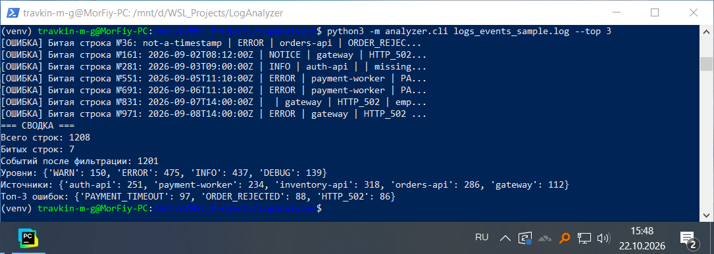
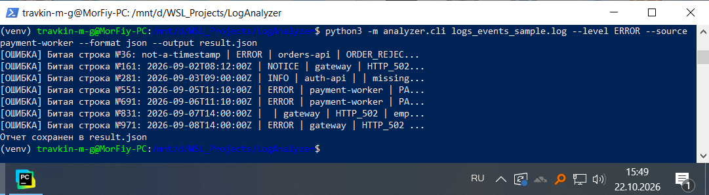
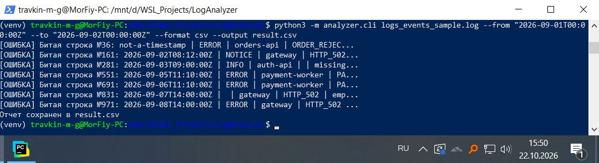
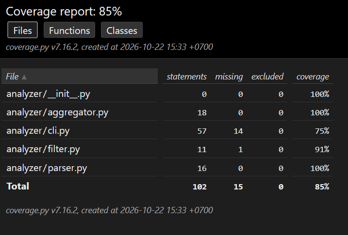

# CLI-анализатор логов

**Выполнил:** Травкин М. Г.
**Дата выполнения:** 22.10.2026

## 1. Бизнес-требования
Службе поддержки требуется утилита для быстрого поиска частых ошибок и их источников в журналах событий. Программа должна работать с большими файлами без загрузки их в оперативную память (потоковое чтение).

## 2. Реализованный функционал
- Чтение логов формата: `timestamp | level | source | eventCode | message`.
- Обработка поврежденных строк (вывод номера строки с ошибкой, продолжение работы).
- Фильтрация по временному интервалу (от и до), уровню логирования и источнику.
- Подсчет статистики: общее количество строк, количество битых строк, сводка по уровням, источникам и Топ-N кодов ошибок.
- Вывод результатов в консоль или сохранение в форматы JSON / CSV.
- Обработка ошибок отсутствия файла.

## 3. Архитектура и стек
- **Язык:** Python 3.12
- **Модули:**
  - `analyzer/parser.py` — разбор строк лога на части и проверка их на корректность (парсинг и валидация).
  - `analyzer/filter.py` — логика фильтрации.
  - `analyzer/aggregator.py` — сбор статистики.
  - `analyzer/cli.py` — интерфейс командной строки.
- **Тестирование:** `pytest`, `pytest-cov`.

## 4. Развертывание и запуск

1. Установите зависимости:
`pip install -r requirements.txt`
2. Запуск базового анализа (Топ-5 ошибок в консоль):
`python3 -m analyzer.cli logs_events_sample.log --top 5`
3. Пример с фильтрацией по уровню и источнику (сохранение в JSON):
`python3 -m analyzer.cli logs_events_sample.log --level ERROR --source payment-worker --format json --output result.json`
4. Пример с фильтрацией по времени (сохранение в CSV):
`python3 -m analyzer.cli logs_events_sample.log --from "2026-09-01T00:00:00Z" --to "2026-09-02T00:00:00Z" --format csv --output result.csv`
5. Пример с фильтрацией только по источнику:
`python3 -m analyzer.cli logs_events_sample.log --source auth-api --top 3`

## 5. Тестирование
Тесты проверяют, что программа правильно обрабатывает как корректные, так и специально испорченные строки лога (например, если пропущено поле или неверно указана дата). Также тесты покрывают работу всех фильтров, правильность подсчета статистики и запуск программы через командную строку.

Для запуска тестов и генерации HTML-отчета выполните одну команду:
   bash run_tests.sh

После выполнения откройте файл `htmlcov/index.html` в браузере.
*(Метрика покрытия: 85%, исключений из подсчета нет).*

## 6. Пример отчета

### Пример 1: Базовый анализ (вывод в консоль)

### Пример 2: Фильтрация по уровню и источнику (JSON)

### Пример 3: Фильтрация по временному интервалу (CSV)

### HTML-отчет о покрытии тестами

---